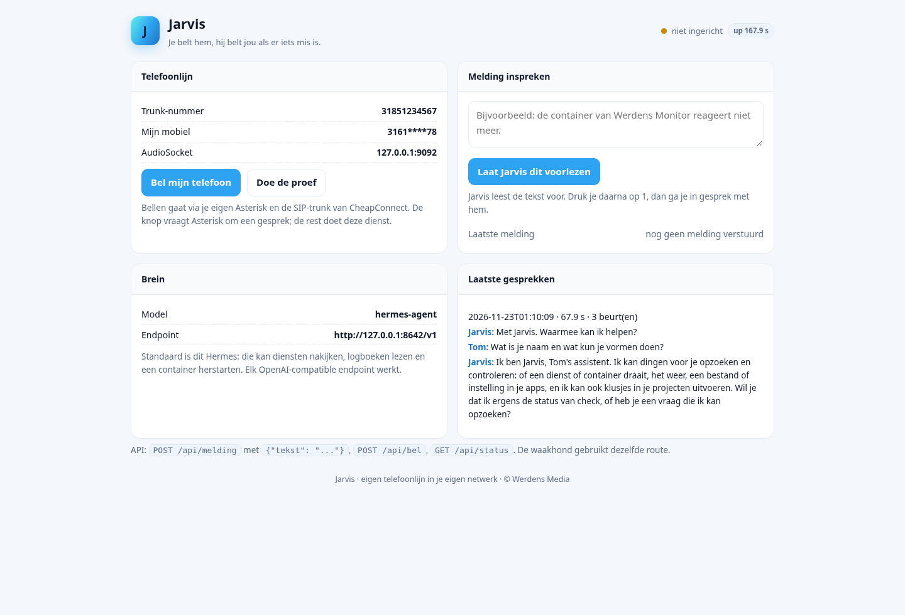
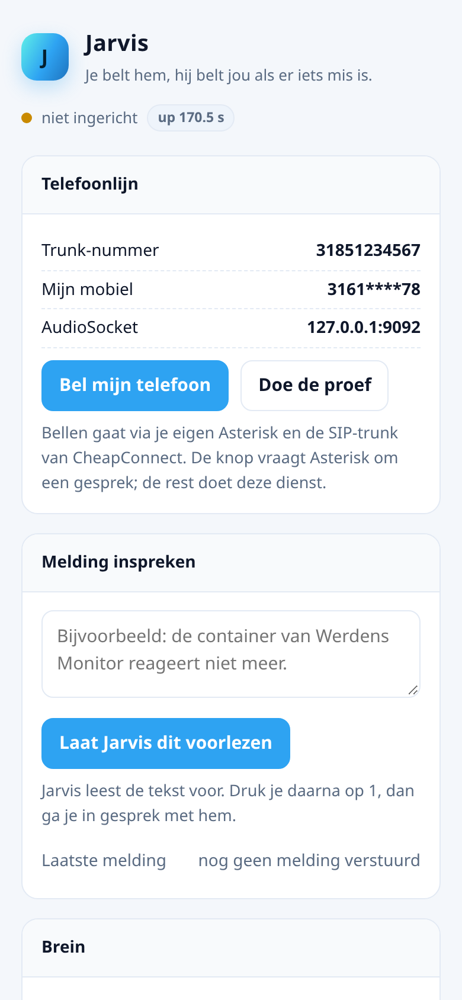

# Jarvis — een AI die je kunt bellen (en die jou belt)



Je belt een nummer en Jarvis neemt op. En gaat er iets mis in je netwerk, dan
belt Jarvis *jou* en leest voor wat er aan de hand is. Alles draait in je eigen
netwerk: Asterisk in een eigen LXC, een SIP-trunk van CheapConnect, whisper.cpp
en piper voor de stem, en als brein elke OpenAI-compatible endpoint — standaard
Hermes, die er ook echt iets aan kan doen (diensten nakijken, logboeken lezen,
een container herstarten).

## Wat je krijgt

- **Inkomend gesprek**: je belt je trunk-nummer, Jarvis neemt op en je praat met
  hem. Hij hoort je (Whisper), denkt na (Hermes), en antwoordt met een stem
  (piper).
- **Uitgaand gesprek (de waakhond)**: elke minuut worden je diensten
  gecontroleerd. Reageert er één niet meer, dan belt Jarvis je mobiel, leest de
  melding voor, en met "1" ga je in gesprek met hem.
- **Statuspagina** met de status van lijn, stem, brein en Asterisk, een knop om
  je telefoon te laten bellen, een veld om een melding te laten voorlezen, en de
  laatste gesprekken mét uitgeschreven tekst.
- **API** (`POST /api/melding`, `POST /api/bel`, `GET /api/status`) zodat je
  eigen scripts dezelfde route gebruiken als de waakhond.



## Installeren (Proxmox)

Op je Proxmox-host als root:

```bash
TRUNK_NUMMER=31612345678 TRUNK_WACHTWOORD=geheim MIJN_MOBIEL=31612345678 \
BREIN_SLEUTEL=jouw-hermes-api-sleutel \
bash <(curl -fsSL https://raw.githubusercontent.com/Theberas04/werdens-jarvis/main/jarvis.sh)
```

Zonder variabelen werkt het ook: dan zet je de trunk-gegevens later in
`/etc/jarvis/jarvis.env` in de container en herstart je `jarvisd`. Het script
maakt de container, installeert Asterisk + spraak + modellen (een paar minuten,
ongeveer 1 GB aan modellen), controleert alles en print aan het eind wat je
waar kunt vinden.

Draai je geen Proxmox maar een gewone Debian-machine, dan kun je
`guest-setup.sh` direct als root uitvoeren.

## Instellingen

Alles staat in `/etc/jarvis/jarvis.env`:

- `TRUNK_NUMMER`, `TRUNK_WACHTWOORD`, `CHEAPCONNECT_HOST` — je SIP-trunk
- `MIJN_MOBIEL` — het nummer dat Jarvis belt, internationaal zonder `+`
- `JARVIS_BREIN_URL`, `JARVIS_BREIN_SLEUTEL`, `JARVIS_BREIN_MODEL` — het brein
- `JARVIS_STEM=lokaal` — of `remote` om de spraak van een andere laag te
  gebruiken (`JARVIS_STT_URL` / `JARVIS_TTS_URL`, OpenAI-compatible op `/v1`)
- `JARVIS_BEGROETING`, `JARVIS_STILTE_MS`, `JARVIS_DREMPEL`, `JARVIS_MAX_GESPREK`
- `JARVIS_GEEN_BELLEN=1` — testen zonder echt te bellen

Na een wijziging: `systemctl restart jarvisd`. Zie
[docs/INSTALLATIE.md](docs/INSTALLATIE.md) voor alle knoppen en
[docs/TELEFOON.md](docs/TELEFOON.md) voor de trunk en je router.

## Wat de waakhond in de gaten houdt

`/etc/jarvis/waken.json`:

```json
{
  "rust_seconden": 1800,
  "stil_van": "23:30", "stil_tot": "07:00",
  "controles": [
    {"naam": "Werdens Monitor", "url": "http://192.168.1.100:8080/health",
     "code": 200, "dringend": true}
  ]
}
```

Hij belt bij de overgang van goed naar stuk, bij de eerste meting die meteen
stuk is, en — als je `meld_herstel: true` zet — als de dienst het weer doet.
`rust_seconden` voorkomt dat je elke minuut gebeld wordt voor dezelfde storing,
`dringend: true` negeert de stille uren.

## Testen zonder telefoon

In de container:

```bash
python3 -m jarvis.jarvisd --zelftest          # spraak in, spraak uit, brein, AMI
python3 -m alarm.wacht --proef                # wat zou de waakhond doen?
python3 -m tools.proefgesprek --vraag vraag.wav --uit antwoord.wav
```

Dat laatste is het echte bewijs: het doet zich voor als Asterisk, stuurt een
opgenomen vraag in en bewaart het antwoord als wav-bestand. Transcribeer dat
terug en je hoort of de keten klopt.

## Eerlijk over de grenzen

- **Dit is beurtgedrag, geen film-Jarvis.** Reken op 3 tot 5 seconden tussen je
  vraag en het antwoord, en je kunt hem niet onderbreken. Op vier CPU-cores
  doet Whisper (base-model) ongeveer 0,3x realtime; het brein erbij is de
  grootste hap.
- **Telefoon is smalbandig (8 kHz).** Eigennamen blijven gevoelig: "Werdens
  Monitor" komt er meestal goed uit, een straatnaam soms niet. Het
  `small`-model (`STT_MODEL=small`) is nauwkeuriger maar ongeveer drie keer
  langzamer.
- **Bellen kost geld per minuut** (NL mobiel circa €0,05/min). Een melding van
  dertig seconden kost ongeveer €0,025; een altijd-luisterende lijn is duurder
  dan een lijn die alleen belt als er iets mis is.
- **Inkomend bellen vraagt een routerregel** (UDP 5060 en 10000-10200 naar de
  container). Uitgaand bellen werkt zonder.

## Hoe het in elkaar zit

```
CheapConnect-trunk (pjsip) <-> Asterisk (dialplan) <-> AudioSocket (TCP)
                                                           |
                                     jarvisd: VAD -> whisper -> brein -> piper
```

| Bestand | Rol |
| --- | --- |
| `jarvis.sh` | installatie op de Proxmox-host |
| `guest-setup.sh` | alles binnen de container |
| `jarvis/jarvisd.py` | de dienst: gesprekken, bellen, statuspagina |
| `jarvis/stem.py` | spraak in (whisper.cpp) en uit (piper) |
| `jarvis/telefoon.py` | AudioSocket-protocol en de Asterisk-manager (AMI) |
| `jarvis/brein.py` | het gesprek met je taalmodel |
| `jarvis/pagina.py` | statuspagina en API |
| `alarm/wacht.py` | de waakhond die belt |
| `asterisk/` | trunk, dialplan, manager, RTP, modules, logboek |
| `tools/proefgesprek.py` | testgesprek zonder telefoon |

## Licentie

© Werdens Media — alle rechten voorbehouden. Geen licentiebestand: dit is
eigen werk, niet bedoeld voor hergebruik zonder overleg. De gebruikte
onderdelen van derden (Asterisk, whisper.cpp, piper, en de stem van
rhasspy/piper-voices) houden hun eigen licentie.
